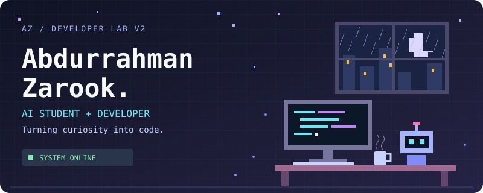

## 01 / Welcome to my lab

I'm an AI undergraduate at **NSBM Green University**, Sri Lanka, with a background in software engineering. I enjoy exploring how intelligent systems and full-stack development can solve real-world problems.

| Currently exploring | Building with |
| :--- | :--- |
| Machine learning & computer vision | Python & JavaScript |
| Intelligent systems & automation | React & FastAPI |
| AI-powered applications | Supabase & Vercel |

## 02 / Developer inventory

| Area | Toolkit |
| :--- | :--- |
| Languages |  |
| Web & APIs |  |
| AI & vision |  |
| Data & deployment |  |
| Tools |  |

## 03 / Lab telemetry

## 04 / The contribution arcade

### Snake

<picture>
  <source media="(prefers-color-scheme: dark)" srcset="https://raw.githubusercontent.com/abdurrahman-44/abdurrahman-44/output/github-contribution-grid-snake-dark.svg" />
  <source media="(prefers-color-scheme: light)" srcset="https://raw.githubusercontent.com/abdurrahman-44/abdurrahman-44/output/github-contribution-grid-snake.svg" />
  
</picture>

### Pac-Man

<picture>
  <source media="(prefers-color-scheme: dark)" srcset="https://raw.githubusercontent.com/abdurrahman-44/abdurrahman-44/pacman-output/pacman-contribution-graph-dark.svg" />
  
</picture>

### 3D contribution city

## 05 / Deep telemetry

## 06 / Lab radio

## 07 / Beyond the lab

Explore my [portfolio](https://abdurrahman-brown.vercel.app/) or browse my [repositories](https://github.com/abdurrahman-44?tab=repositories). I'm open to collaboration and learning opportunities.

